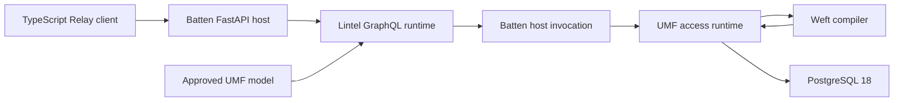

---
ddx:
  id: lintel.architecture
  type: architecture
  activity: design
  authoring:
    home: repo
  links:
    - id: lintel.prd
      kind: informed_by
    - id: ADR-001
      kind: informed_by
    - id: ADR-002
      kind: informed_by
  schemas:
    - id: lintel.source.umf-commerce
      version: "0.10.0"
      title: Pinned UMF commerce source for design inspection
      path: docs/helix/00-discover/sources/umf-commerce.json
      schemaFormat: umf
---

# Lintel architecture

## Scope

An independently packaged Python GraphQL/Relay runtime, embedded in Batten's
FastAPI host. UMF owns model meaning; Weft owns SQL compilation; existing access
runtimes own native execution; Batten owns admission and current authority.
Lintel owns API projection, Relay identity/connection adaptation and client build
integration. This is the target architecture, not an implemented deployment. UMF remains the
schema authority and direct input. No intermediate metadata service or second
schema format is introduced. An ORM may return its underlying UMF JSON unchanged;
execution capabilities remain separate from model declarations.

## Level 1: System Context

| Element | Type | Purpose | Protocol |
| --- | --- | --- | --- |
| Batten application author | User | Select UMF exposure and author browser operations | Approved model and GraphQL documents |
| TypeScript Relay client | Consumer | Query, page, refetch and mutate | GraphQL over host HTTP |
| Batten host | Embedder | Admit app, authenticate actor, authorize, confirm and attribute | Public async host/provider APIs |
| UMF / Weft / access runtime | Upstream | Describe semantics, compile and execute | Public Python boundaries |
| Family documentation | Static site | Explain project, support and integration | GitHub Pages; no runtime execution |



## Level 2: Container Diagram

| Container | Technology | Responsibilities | Communication |
| --- | --- | --- | --- |
| Batten API process | Python 3.11+, FastAPI/ASGI, proposed Strawberry integration | Mount Lintel, authenticate, enforce host gates, async execution | HTTP outward; public in-process APIs inward |
| Execution provider | Existing Python umf_access + native Weft wheel | Prepared/admitted operation execution and resource custody | Driver-bound PostgreSQL 18 |
| Database | PostgreSQL 18; published native baseline 18.6 | Data, native policy and durable outcomes | Existing session adapter |
| Browser application | TypeScript, Relay runtime | Compiled fragments/operations and scoped normalized store | GraphQL HTTP through Batten |
| Build tools | uv/Python; Relay compiler driven by Bun | Lock cohort, export schema, generate/check client artifacts | Local files, no startup package downloads |

The execution provider is in-process for the MVP. No sidecar, broker or second
service is needed. Optional deployment isolation must preserve the same host seam.

## Module Boundaries

**Source Applicability**: source; planned Python adapters and TypeScript build/client
integration. The paths below are proposed modules, not existing implementation.

| Module | Responsibility / Owned Types | Public API | Allowed Dependencies | Forbidden Dependencies |
| --- | --- | --- | --- | --- |
| `src/lintel/projection/` | Immutable exposed API plan and diagnostics | Projection/export facade; CONTRACT-001 | Admitted UMF JSON; public UMF reader/validator; neutral value types | FastAPI, Strawberry, Batten, drivers, duplicated UMF semantics |
| `src/lintel/relay/` | Node identity and connection/selection mapping | Relay adaptation facade | Projection and public runtime capability values | SQL, drivers, global actor caches, offset fallback |
| `src/lintel/graphql/` | Executable dynamic schema, scalar coercion, async resolvers, cost validation | prepare_api; CONTRACT-005 | Projection, Relay, public ports, Strawberry; injected dispatch | Concrete runtime construction, private Batten/UMF internals |
| `src/lintel/asgi/` | FastAPI router, trusted request context and readiness | create_router / create_app; CONTRACT-005 | GraphQL facade, FastAPI/Starlette | Native drivers, policy engines, engine discovery |
| `src/lintel/ports.py` | Framework-neutral execution/context/capability protocols | ExecutionPort / RequestSession / NodeCodec; CONTRACT-002 | Python stdlib and neutral projection values | Batten packages, FastAPI/Strawberry, drivers, concrete executors |
| `src/lintel/hosting/` | Standalone/embedded composition and typed settings | Composition factories | Selected public adapters; host-injected resources | Startup installs, schema-selected imports, implicit migrations |
| `tools/relay/` | SDL export consumption, pinned compiler invocation, manifests | Build/check workflow | Relay compiler, TypeScript/Bun | Server semantic implementation, startup installation |
| `packages/client/` | Host-configured network and exact scalar helpers | Relay environment/network factory | Browser APIs and Relay public runtime | Python, native engines, provider credentials, Bun/Node at runtime |

**Integration Owners**: UMF document -> projection; Relay protocol -> relay;
Strawberry -> graphql; FastAPI -> asgi; client compiler -> tools/relay.
Batten owns its proposed `batten.lintel` adapter in the Batten repository. That
adapter implements Lintel's neutral public ports using Batten's public host APIs.
Lintel imports no Batten package; Batten core imports no Lintel or GraphQL adapter.
Batten retains the native table/graph provider integration.

**Construction Policy**: Batten's host composition supplies actor resolution,
public invocation, approved model and ownership. Lintel factories receive these
explicitly. The embedding composition root constructs `batten.lintel` and injects
its router/binding; generic Batten core and ASGI modules do not discover or import
the optional adapter. No process-global schema registry or implicit provider construction.

**Boundary Check**: `uv run --group spike python scripts/check_boundaries.py`
checks the bounded spike module graph with allowed, forbidden, reverse-import
and private-import controls. The spike module map and limitations are in
the execution record. Product source and the
planned `bun run check:client-boundaries` require their own checks before handoff.

## Deployment

| Component | Infrastructure | Instances | Scaling | Backup / Recovery |
| --- | --- | --- | --- | --- |
| MVP host | Local Batten ASGI/Uvicorn process | One | Bounded concurrency; no capacity claim | Rebuild immutable model/cohort and restart |
| Native provider | Existing Batten-owned PostgreSQL 18 service | One reference instance | Existing connection limits | Upstream data/receipt backup policy |
| Databricks host | Databricks Apps FastAPI deployment profile | Platform-managed; unmeasured | Workspace/runtime qualification required | Redeploy pinned app artifact; data stays upstream |
| Family docs | Proposed `/lintel/` GitHub Pages project site | Static | Host-managed | Rebuild from governed sources |

Databricks Apps packaging needs approved app configuration and dependency export.
The gateway's user identity and app service-principal identity must remain distinct;
workspace access is not evidence of native per-user PostgreSQL authorization.
No Lakebase, Unity Catalog, Databricks SQL or production-host qualification is
inherited from the Databricks Apps deployment target.

## Data Flow

Illustrative sequence: author opens a task list, expands assignees and completes
a task. Boxes name target responsibilities; arrows do not represent executed proof.

```mermaid
%% id: lintel-request-flow
%% source: docs/helix/02-design/architecture.md
sequenceDiagram
  participant C as Relay browser
  participant G as Batten/Lintel GraphQL
  participant H as Batten host
  participant R as UMF runtime
  participant P as PostgreSQL 18
  C->>G: Compiled query + variables
  G->>G: Resolve app/actor; validate cost and active schema
  G->>H: Authorized bounded read/relationship calls
  H->>R: Current identity, admitted operation and inputs
  R->>P: Native checked execution
  P-->>R: Rows, typed positions and outcomes
  R-->>G: Exact values and connection evidence
  G-->>C: Nodes, edges and honest PageInfo
  C->>G: Declared mutation + retained invocation key
  G->>H: Current authorization + confirmation
  H->>R: Invoke authoritative command
  R-->>G: Applied / recovered / unknown
  G-->>C: Typed result; no automatic retry
```

## Quality Attributes

| Attribute | Target | Strategy | Verification |
| --- | --- | --- | --- |
| Fidelity | Zero silent conversions in selected corpus | Shared exact carriers; unsupported semantics refuse | Native-to-GraphQL-to-browser comparisons |
| Isolation | Zero cross-app/actor cache or resource reuse in adversarial corpus | Request loaders and actor/app-scoped Relay environments | Two principals and two apps, same logical keys |
| Resource bounds | Finite mandatory page/depth/cost/alias/timeout/body limits | Reject before effects; retain upstream stricter bounds | Boundary/over-limit cases; no partial writes |
| Relationship efficiency | Native call count bounded by selected relationship fields/chunks, not parent row count | Runtime batched key/related read | Compare 1 vs 50 parents with native observations |
| Mutation safety | Zero automatic mutation retries | Preserve invocation key and upstream observation semantics | Commit/lost-response/cancellation controls |
| Lifecycle | Zero startup DDL or dependency downloads | Prepared artifacts; explicit admin deployment | Denied network/install and native-DDL observation |

CONTRACT-005 defines explicit initial numeric limits. No latency,
availability, fleet size or disaster recovery SLO has been measured for Lintel.

## Decisions and Tradeoffs

| Decision | Status | Rationale | Follow-up |
| --- | --- | --- | --- |
| Separate Python runtime embedded in Batten | Owner direction; ADR-001 | Fits FastAPI and reuses native Python access | Public Batten extension/cohort qualification |
| GraphQL + Relay only | Owner direction; ADR-002 | Standard node/refetch/connection and typed client workflow | Exact supported profile and Relay tests |
| Startup construction, immutable active schema | MVP assumption | Avoid schema mutation during active requests | Restart/replace cohort for changes |
| Strawberry adapter | Proposed, reversible | FastAPI/Relay integration documented upstream | Dynamic schema/scalar/async spike |
| Declared operations first | MVP constraint | Existing native table path is strongest baseline | Runtime batching/edge-cursor gaps remain blockers |

## Architecture Walkthrough

Startup reads the approved UMF JSON directly through public UMF parsing and
validation, validates exposure and runtime capabilities and constructs
one immutable schema. Export and runtime use the same plan/digest. Hidden
constraints remain interpreted upstream; hiding their API fields never removes them.
No API-selected meaning may be silently omitted to achieve activation.

Reads map selections to admitted operations. Resolvers batch selected relationship
loads and never fetch an unbounded iterable to let a library slice it in memory.
Every fetched node is authorized, including refetch and relationships. Request
consistency must satisfy Relay field stability; request caches alone do not prove
snapshot semantics under concurrent updates. CONTRACT-002 selects request-snapshot-1; the native spike must qualify it.

Node identity namespaces the stable app/model type and exact key tuple. It is
opaque, never a credential and never contains secret key material. Mutable source
hashes are not inserted into every Node ID: compatible source edits should preserve
normalized identity. Deployments/models with different authority domains require
explicit namespaces and separate client stores. Key replacement breaks identity.

GraphQL nullability is an API promise as well as storage meaning. A required
native relationship can still be hidden by authority; projection must model that
visibility without leaking a target or triggering unexpected non-null bubbling.
A missing output property cannot silently collapse into an explicit null when
its declared meaning distinguishes them; use a supported presence representation
or refuse that selected projection.

GraphQL's reserved node `id` is separate from any native field of the same name;
projection naming/collision handling must preserve the original UMF field identity.
Per-edge cursor positions and PageInfo require runtime evidence. Page-next tokens
alone cannot be relabeled as edge cursors. Forward pagination is the MVP profile;
unsupported backward arguments are absent, and reverse-page boolean meaning must
be truthful. Full Relay compatibility needs its independent conformance checks.

Mutations invoke declared commands, not client-authored effects. GraphQL mutation
field serialization is not a cross-field transaction or exactly-once guarantee.
Batten still owns confirmation, current authorization and attribution. An unknown
outcome is exposed with recovery identity; a retry never follows automatically.

Browser types come from selected operation/fragment documents plus exported SDL,
not from enumerating every possible query. Custom scalars use documented wire
carriers and TypeScript mappings; a type alias does not perform runtime decoding.
Client/schema manifests and Relay stores bind to the application/cohort context.


## Shared contract map

- [CONTRACT-001](contracts/CONTRACT-001-exposure-and-projection.md): exposure and deterministic projection.
- [CONTRACT-002](contracts/CONTRACT-002-neutral-execution-port.md): neutral async runtime and identity boundary.
- [CONTRACT-003](contracts/CONTRACT-003-graphql-relay-profile.md): GraphQL/Relay server, exact values and outcomes.
- [CONTRACT-004](contracts/CONTRACT-004-typescript-relay-clients.md): TypeScript artifact and network lifecycle.
- [CONTRACT-005](contracts/CONTRACT-005-hosting-and-resource-bounds.md): ASGI/HTTP/lifecycle and finite limits.

These define desired versioned interfaces, not a claim that an upstream provider
or the candidate Strawberry/Relay toolchain already implements them. In
particular, direct UMF-to-Python projection, native edge cursors/snapshot and
operation-aware response scalar validation remain bounded interoperability work.
